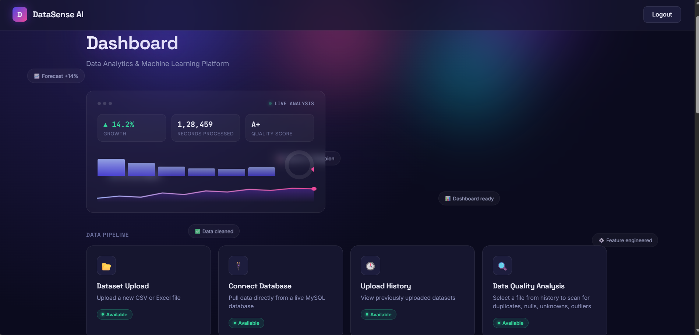
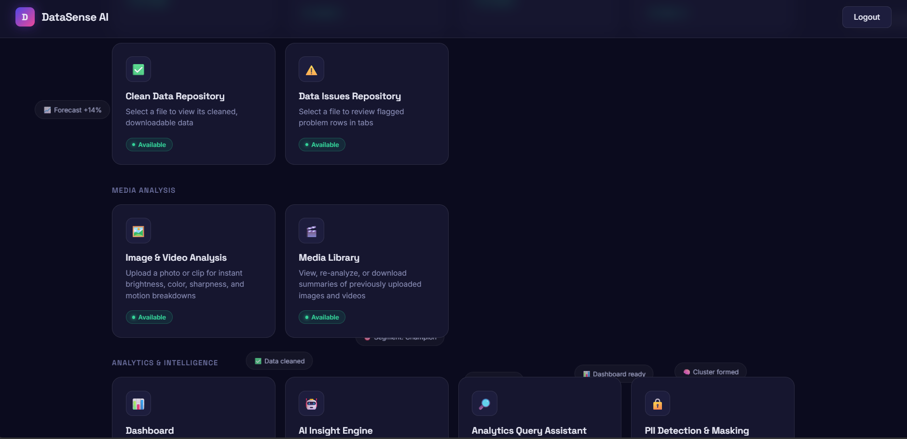
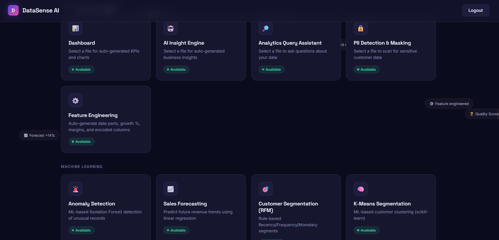
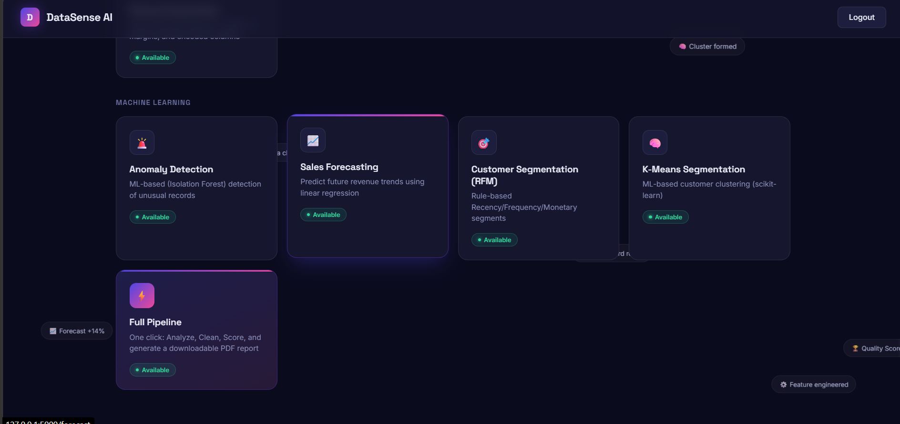
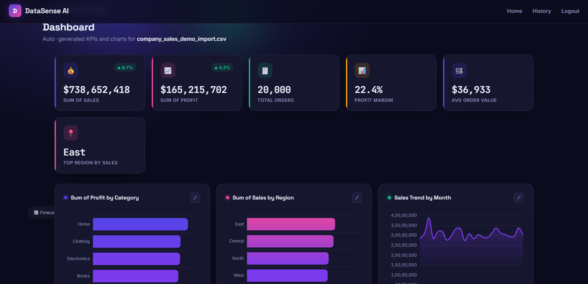
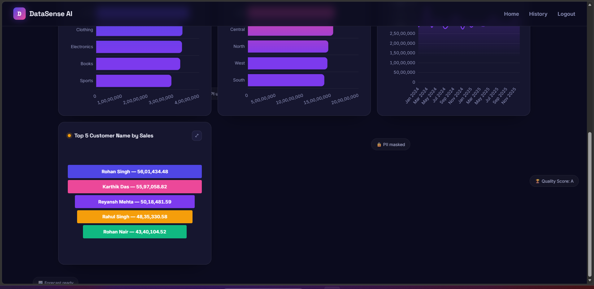

# DataSensAI

DataSensAI turns raw data into real insights: automated cleaning, PII detection, smart segmentation, forecasting, and Claude-powered analytics in one platform.

DataSensAI is a full-stack data analytics platform designed to streamline the entire data science workflow within a single, intuitive web application. Built with Flask and Python, it enables users to upload datasets and automatically clean, validate, and profile their data for quality issues. The platform includes built-in PII detection to help identify sensitive information before analysis, along with automated exploratory insights powered by Claude AI, with a rule-based fallback when no API key is configured. Users can perform customer segmentation using RFM and K-means clustering, generate time-series forecasts, detect anomalies, and build interactive dashboards to visualize trends. DataSensAI also supports direct database connections, custom querying, and media analysis.

## Screenshots

### Dashboard

### Feature Modules

### Analytics & Charts

## Features
- **Data Upload & Cleaning** — Upload CSV/Excel files and automatically clean, validate, and profile data quality issues
- **PII Detection** — Scan datasets for personally identifiable information before analysis
- **AI-Powered Insights** — Generate automated insights using Claude AI, with a rule-based fallback when no API key is set
- **Customer Segmentation** — RFM (Recency, Frequency, Monetary) analysis and K-means clustering
- **Forecasting** — Time-series forecasting for trend prediction
- **Anomaly Detection** — Identify outliers and unusual patterns in data
- **Interactive Dashboards** — Build and visualize dashboards from processed data
- **Database Connectivity** — Connect directly to external databases and run custom queries
- **Media Analysis** — Analyze uploaded media files
- **Report Generation** — Export findings as PDF reports

## Tech Stack

- **Backend:** Python, Flask
- **Database:** MySQL (via `mysql-connector-python`)
- **Data Processing:** pandas, NumPy, scikit-learn, SciPy
- **AI:** Anthropic Claude API
- **PDF Reports:** fpdf2
- **Frontend:** HTML, Jinja2 templates

## Project Structure

